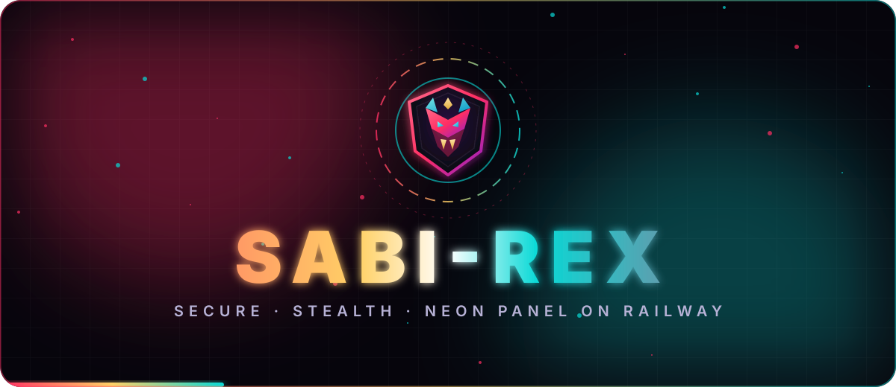
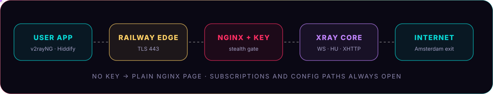

<p align="center"></p>

<p align="center">
    
</p>

<div dir="rtl">

<h1 align="center">⬢ سابی‌رکس</h1>
<h3 align="center">پنل اختصاصی، تیره و نئونی، که از بیرون هیچ اثری از خودش نشان نمی‌دهد.</h3>

<p align="center">
<b>۱۲ کانفیگ آماده</b>، <b>ورودی مخفی با کلید</b>، <b>پنل نمایندگی</b>، صفحه‌ی اشتراک <b>REX PASS</b> و <b>نگهبان خودکار</b>.<br>
بدون سرور، بدون ترمینال، بدون سرتیفیکیت دستی.
</p>

<p align="center"></p>

<p align="center"></p>

##  چرا سابی‌رکس؟

<p align="center"></p>

| | پنل معمولی | **SABI-REX** |
|---|---|---|
| آدرس پنل | همه می‌بینند | **فقط با کلید مخفی** |
| صفحه‌ی اصلی دامنه | صفحه‌ی ورود پنل | **صفحه‌ی ساده‌ی nginx** |
| مسیرهای ناشناخته | خطای پنل | **404 معمولی** |
| رمز اولیه | `admin/admin` | **تصادفی یا انتخاب خودت** |
| حالت خرابی | محدودیت‌ها دور زده می‌شوند | **پنل بسته می‌شود (امن)** |
| ظاهر | پیش‌فرض | **Obsidian Neon + لوگوی اختصاصی** |
| تعمیر خودکار | ندارد | **چک هر ۱۵ ثانیه** |
| بکاپ | دستی | **روزانه، ۷ نسخه‌ی آخر** |

<p align="center"></p>

##  نصب در ۷ قدم

> [!TIP]
> کل نصب حدود **۵ دقیقه** است. فقط یک حساب GitHub و یک حساب Railway لازم داری.

| قدم | کار | نکته |
|---|---|---|
| **۱** | **Star** و بعد **Fork** | |
| **۲** | در Railway: `New Project` ← `Deploy from GitHub repo` | ریپوی Fork شده را انتخاب کن |
| **۳** | `Settings` ← `Regions` ← **EU West (Amsterdam)** | کمترین پینگ از ایران |
| **۴** | `Attach Volume` با مسیر **`/var/lib/sabirex`** | بدون Volume اطلاعات پاک می‌شود |
| **۵** | `Networking` ← `Generate Domain` با پورت **`8080`** | |
| **۶** | **App Sleeping** را خاموش کن | |
| **۷** | متغیرهای زیر را بگذار و **Deploy** کن | |

```dotenv
CORE_IMAGE=<تصویر هسته>
REX_PANEL_KEY=یک_کلید_۱۶_تا_۶۴_حرفی
REX_INIT_PASSWORD=رمز_اول_حداقل_۱۰_حرف
PANEL_DOMAIN=panel.example.com   # اختیاری
```

<details><summary><b>در لاگ دیپلوی چه باید ببینم؟</b></summary>

```
=== ⚡ SABI-REX on Railway ===
[start] secret entrance ready: https://<your-domain>/<key>
[lock] xray test: config OK
[start] region: europe-west4 (Amsterdam = best for Iran)
[guard] region Amsterdam | 12 direct methods
```
</details>

<p align="center"></p>

##  ورود

| | آدرس |
|---|---|
| **پنل مدیر** | `https://DOMAIN/<REX_PANEL_KEY>` |
| **پنل نماینده** | `https://DOMAIN/<REX_PANEL_KEY>/agent` |
| **نام کاربری** | `admin` |
| **رمز** | مقدار `REX_INIT_PASSWORD`، یا رمز تصادفی چاپ‌شده در لاگ اول |

> [!WARNING]
> با اولین ورود، از منوی پنل گزینه‌ی **«تغییر نام کاربری و رمز عبور»** را بزن. کلید مخفی را فقط به افراد مورد اعتماد بده.

<p align="center"></p>

##  معماری

<p align="center"></p>

Railway روی پورت **443** TLS را مدیریت می‌کند و همه‌چیز را به nginx روی **8080** می‌دهد. nginx بدون کوکی کلید، فقط صفحه‌ی ساده یا 404 نشان می‌دهد. لینک‌های اشتراک و مسیرهای کانفیگ همیشه باز هستند.

<p align="center"></p>

##  ۱۲ کانفیگ آماده

اسم همه با **سابی‌رکس | 𝗦𝗔𝗕𝗜-𝗥𝗘𝗫** شروع می‌شود.

| # | کانفیگ | پروتکل · انتقال | اثرانگشت | فرگمنت |
|---|---|---|---|---|
| 01 | **Amsterdam Rocket** | VLESS · WS (REX Core) | ios | — |
| 02 | **Ghost Anti-Filter** | VLESS · WS (REX Core) | chrome | قوی |
| 03 | **Hyper Drive** | VLESS · WS | firefox | — |
| 04 | **Swift Shield** | VLESS · WS | chrome | سبک |
| 05 | **Vortex** | VMess · WS | safari | — |
| 06 | **Trident** | Trojan · WS | edge | — |
| 07 | **Ninja Stealth** | Trojan · WS | random | قوی |
| 08 | **Lightning** | VLESS · HTTPUpgrade | chrome | — |
| 09 | **Meteor** | VLESS · HTTPUpgrade | ios | سبک |
| 10 | **Warp Speed** | VLESS · XHTTP (packet-up) | chrome | — |
| 11 | **Nebula** | VLESS · HTTPUpgrade | firefox | — |
| 12 | **Quantum** | VLESS · XHTTP (stream-up) | edge | — |

> [!TIP]
> فیلترینگ هر روز فرق می‌کند. در اپ از همه **Real Delay** بگیر و کم‌پینگ‌ترین را بزن. آدرس تست را `http://cp.cloudflare.com/` بگذار.

<p align="center"></p>

##  پنل نمایندگی

- پکیج‌های آماده و **حجم دلخواه از ۱ مگابایت تا نامحدود** (MB / GB / TB)
- محدودیت **تعداد کاربر، حجم و تاریخ انقضا** سمت سرور
- **شارژ و تمدید** در یک مرحله، **تاریخچه‌ی کامل**، جستجو و فیلتر
- هر نماینده فقط کاربران خودش را می‌بیند

<p align="center"></p>

##  نگهبان خودکار

| اگر این خراب شود | واکنش |
|---|---|
| **nginx** | ظرف ۱۵ ثانیه دوباره روشن می‌شود |
| **هسته‌ی Xray** | دست‌دادن واقعی WebSocket؛ در صورت خرابی ری‌استارت |
| **رم** | در ۹۷٪، ری‌استارت آرام هسته |
| **پنل** | بعد از ۳ چک ناموفق، بالا آمدن تمیز |
| **صفحه‌ی اشتراک** | بازگشت از نسخه‌ی سالم |
| **دیتابیس** | بکاپ روزانه، ۷ نسخه‌ی آخر |

<p align="center"></p>

##  امنیت و استتار

| | |
|---|---|
| **ورودی مخفی** | کلید ۱۶ تا ۶۴ حرفی + کوکی HttpOnly و Secure |
| **صفحه‌ی پوششی** | `/` صفحه‌ی پیش‌فرض nginx، بقیه 404 معمولی |
| **بدون اثرانگشت** | API، مستندات، وضعیت و فایل‌های ظاهر بدون کلید بسته‌اند |
| **قفل ورود** | ۱۰ تلاش ناموفق = ۵ دقیقه قفل (روی IP و نام کاربری) |
| **حالت اضطراری امن** | خرابی تنظیمات = بسته شدن پنل، نه دور زدن محدودیت‌ها |
| **نشست کوتاه** | اعتبار ورود ۲۴ ساعت |
| **پورت‌های داخلی** | پنل و Xray فقط روی `127.0.0.1` |

<p align="center"></p>

##  متغیرها

| متغیر | پیش‌فرض | توضیح |
|---|---|---|
| `CORE_IMAGE` | — | تصویر هسته‌ی پنل (الزامی) |
| `REX_PANEL_KEY` | تصادفی | کلید ورودی مخفی |
| `REX_INIT_PASSWORD` | تصادفی | رمز اولین نصب |
| `PANEL_DOMAIN` | دامنه‌ی Railway | دامنه‌ی شخصی |
| `RESET_ADMIN_PASSWORD` | — | `1` = بازگشت رمز به مقدار اولیه |
| `REX_XHTTP` · `REX_FAST` · `REX_ADBLOCK` | `1` | `0` = خاموش |
| `REX_FRAGMENT` | `10-20,10-20,tlshello` | فرگمنت قوی |
| `REX_OLD_PATHS` | `0` | مسیرهای قدیمی بسته |
| `DOCTOR_TG_TOKEN` · `DOCTOR_TG_CHAT` | — | هشدار نگهبان در تلگرام |

فهرست کامل در [`variables.env`](variables.env).

<p align="center"></p>

##  به‌روزرسانی

در ریپوی خودت **Sync fork** ← **Update branch**. Railway خودش دوباره Deploy می‌کند و **کاربران، رمزها و نماینده‌ها دست نمی‌خورند.**

<p align="center"></p>

##  سؤال‌ها

<details><summary><b>آدرس دامنه فقط Welcome to nginx نشان می‌دهد</b></summary>
عمدی است. پنل را از <code>https://DOMAIN/&lt;REX_PANEL_KEY&gt;</code> باز کن.
</details>
<details><summary><b>کلید را فراموش کردم</b></summary>
در Railway متغیر <code>REX_PANEL_KEY</code> را ببین یا یک مقدار جدید بگذار و Redeploy کن.
</details>
<details><summary><b>رمز را فراموش کردم</b></summary>
<code>RESET_ADMIN_PASSWORD=1</code> بگذار، Redeploy کن، وارد شو و بعد متغیر را پاک کن.
</details>
<details><summary><b>بعد از Redeploy کاربرها پاک می‌شوند</b></summary>
Volume روی <code>/var/lib/sabirex</code> وصل نیست.
</details>
<details><summary><b>کانفیگ‌ها بعد از مدتی قطع می‌شوند</b></summary>
App Sleeping را خاموش کن.
</details>

</div>

<p align="center"></p>
